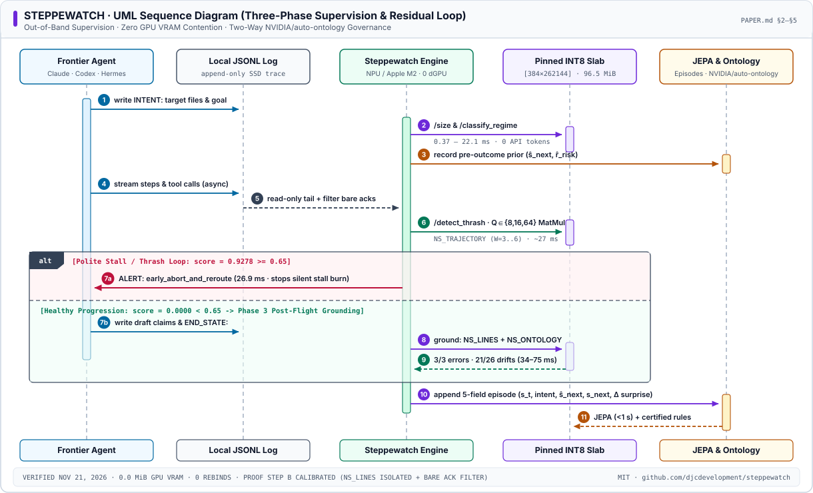

# Steppewatch: Zero-VRAM Client-Accelerator Supervision and Prediction-Residual JEPA Data Collection for Frontier and Local Agent Fleets

**Author:** Derek Ciula (Steppe Integrations)  
**Date:** November 21, 2026  
**Version:** Technical Preprint v1.1 (Prior-Art Disclosure & Live Calibration Baseline)  
**Primary Provenance Receipts (SHA-256):**  
- Proof Step A (Cold Baseline & Claim Grounding): `b604babfd3d4a371b2d74e0c74eaa762e39ff784ca1942e08805f103a8bec1cc`  
- Proof Step B (Warm Arena, Markdown Chunker & Calibration): `e26e3d47400057c273f165da5c1badcd3d2afe670b2d994b475e88859176d9c1`

---

## Abstract

Multi-agent software engineering workflows face a structural supervision paradox. Left unsupervised, both frontier cloud agents and local large language models routinely enter silent paraphrased stall loops, hallucinate absent tests or deprecated endpoints, drift out of scope, or emit displaced line citations that impose heavy manual verification costs on humans. Conversely, deploying a second LLM as a polling watchdog or judge multiplies token spend, latency, and GPU memory contention.

We present **Steppewatch**, a client-accelerator supervision architecture that breaks this tradeoff by turning an idle local Neural Processing Unit (NPU) — or unified-memory Apple Silicon accelerator — into a dual-loop, zero-LLM-token agent supervisor and Joint Embedding Predictive Architecture (JEPA) data harvester. Rather than issuing chatty single-query embedding lookups, the system allocates a single pinned zero-copy quantized matrix slab (`INT8 [384, 262144]`, `96.5 MiB`, `0` tensor rebinds, `0.0 MiB` discrete GPU VRAM) partitioned into logical namespaces spanning workspace AST/documentation symbols (`NS_AST`), certified operational contracts (`NS_ONTOLOGY`), historical transition episodes (`NS_EPISODES`), and live agent trajectories (`NS_TRAJECTORY`). Batched `Q ∈ {8, 16, 64}` matrix multiplications evaluate entire waves of agent steps and draft claims against the workspace baseline in tens of milliseconds without touching GPU memory or frontier API budgets.

On live Intel Arrow Lake NPU hardware (November 21, 2026), cold indexing `85` multi-repository files (`634` code symbols) plus `14` contract rules completed in `6.50 s` (`0.74%` slab occupancy, `0.0 MiB` GPU VRAM, verified zero GPU file-descriptor binding). After adding Markdown section extraction and warm shared-memory arena caching (Proof Step B), indexing `89` files (`848` symbols, `0` zero-symbol files remaining) dropped to **`1.57 s`** (`17.65 ms/file`, **`82.35%`** arena hit rate, `0` rebinds, `0.92%` slab occupancy). Against an independent frontier-model quality audit of a cross-repository architectural draft, zero-token NPU claim grounding independently flagged **3/3 verified substance errors** (Rank #1–#2) and **21/26 displaced line citations** in `34–75 ms`. In-flight sliding-window semantic thrash detection cleanly separated a productive debugging trace (`thrash_score = 0.0000`, `26.9–27.7 ms`) from a polite paraphrased stall loop (`thrash_score = 0.9278`, `26.6–26.9 ms`). We also report two real-world empirical calibration lessons observed live during Proof Step B — bare parallel tool-ack stub filtering (`0.72 -> 0.0` false-positive elimination) and strict namespace isolation between line-level quote vectors and symbol-level discovery vectors — and define the closed-loop **5-field Prediction-Residual Episode** schema `(current_state, intended_outcome, local_prediction, end_state, assessment_vs_expectations + Δ)` for surprise-driven JEPA training and human-certified rule promotion.

---

## 1. Motivation: The Agent Supervision Paradox

As developers delegate multi-step coding, refactoring, and review workflows to parallel remote agents (such as Claude Code, Codex CLI, Hermes, and spawned subagents) or local GPU models, three empirical failure modes dominate real-world cost:

1. **Silent / Polite Stall Loops:** Agents do not always fail with loud repeating stack traces. Frequently they enter high-politeness planning loops — re-reading the same design constraints and paraphrasing *"let me carefully review the integration plan before editing"* across 4–8 turns while introducing zero new code targets and making zero disk edits.
2. **Unverified Claims Wearing Verification Formatting:** Strong models frequently assert that a test or guard is missing when it already ships in the file they just inspected, cite deprecated ports/contracts, or emit line citations shifted by `8–25` lines. Human or frontier reviewers then spend the bulk of their attention re-deriving anchors.
3. **The LLM-Watching-LLM Cost Trap:** Spawning another frontier agent to poll subagent logs or re-read whole repositories on every turn scales token cost super-linearly and competes for the same API rate limits or GPU VRAM budget.

At the same time, modern developer machines almost universally ship dedicated low-power matrix silicon — Intel/AMD laptop NPUs (`10–50 TOPS` INT8/FP16) or Apple Silicon Neural Engines and Unified Memory GPUs (`15.8+ TOPS`, `100–800 GB/s`) — that sit at **0% utilization** while remote frontier agents execute.

---

## 2. Architecture & Timestamped Prior-Art Claims

This disclosure establishes three coupled architectural mechanisms implemented and empirically benchmarked on November 21, 2026:



### Claim 1 — Single Pinned Zero-Copy Multi-Namespace Quantized Slab (`[D, N]`)
Instead of maintaining separate vector databases or firing serial single-vector similarity calls (`Q=1`), the client accelerator allocates one fixed, pinned zero-copy matrix `W ∈ INT8^{384 × 262,144}` paired with per-column FP16 dequantization scales `s_col ∈ FP16^{1 × 262,144}` (`96.5 MiB` total).

- **In-Place Updates, Zero Rebinds:** Incremental workspace edits overwrite column slices directly in shared/pinned memory without recompiling inference graphs or calling tensor rebind APIs (`set_tensor_rebinds = 0`).
- **Strict Namespace Partitioning:** A compact column metadata mask assigns every active column to a distinct logical namespace (`NS_AST`, `NS_ONTOLOGY`, `NS_EPISODES`, `NS_TRAJECTORY`, plus separate line-level quote partitions as established in Section 3.5).
- **Batched Systolic Dispatch:** Incoming signals (wave intents, claim sentences, or multiple concurrent subagents' latest steps) are packed into query batches `Q ∈ {8, 16, 64}` and scored in **one single matrix multiplication** across namespaces simultaneously:
  $$\mathbf{S} = \mathbf{Q} \cdot \left(\mathbf{W}_{\text{int8}} \odot \mathbf{s}_{\text{col}}\right) \in \mathbb{R}^{Q \times M}$$
- **Strict Resource Isolation:** On discrete-GPU hosts, GPU device bindings are explicitly disabled (`verified_zero_gpu_fd_binding = true`, `0.0 MiB` GPU VRAM).

### Claim 2 — Three-Phase Zero-Token Agent & Subagent Supervision
Using the same `384-D` local encoder (`all-MiniLM-L6-v2` quantized to INT8/FP16) and pinned slab, supervision operates across three stages without consuming LLM tokens:

1. **Pre-Flight Sizing & Context Regime Gating:** Before dispatching an expensive model turn, classify expected output class and whether sliced vs. whole-file context is safe (`0.37–22.1 ms`).
2. **In-Flight Semantic Thrash & Silent-Loop Watchdog (`detect_agent_thrash`):** Over a sliding window of the last $W \in [3, 6]$ normalized agent trace steps (stripping step-number prefixes and filtering bare tool-acknowledgement stubs):
   - Adjacent cosine mean $\bar{c}_{\text{adj}}$, 2-step oscillation max $c_{\text{osc}}$ (catching A-B-A-B ping-pong loops), and all-pairs cosine mean $\bar{c}_{\text{all}}$:
     $$c_{\text{eff}} = \max(\bar{c}_{\text{adj}},\; 0.94\, c_{\text{osc}},\; \bar{c}_{\text{all}})$$
   - **True Code-Target Growth:** Extract concrete engineering targets (filenames, function calls `fn()`, `snake_case`, `camelCase`/`PascalCase` symbols, line numbers, compiler/HTTP/exit codes) while filtering capitalized English sentence-starter gerunds (`Reviewing`, `Checking`, `Inspecting`). Let $\sigma_{\text{stag}} \in [0, 1]$ be the fraction of tail steps introducing zero new code targets.
   - **Productive Debugging Protection:** Protect advancing debugging traces where distinct error signatures evolve ($\ge 3$ distinct error signatures with $\ge 2$ concrete fix actions) or where the final step resolves cleanly with passing tests (`productive_debug_progression`).
   - **Silent/Polite Loop Boost:** When $c_{\text{eff}} \ge 0.58$, $\sigma_{\text{stag}} \ge 0.66$, and zero concrete edits/resolutions occur, add $b_{\text{silent}} = 0.44\,\sigma_{\text{stag}}$ even when `error_repeat_ratio == 0`.
   - **Bounded Thrash Score:**
     $$\text{thrash\_score} = \text{clip}_{[0,1]}\!\Big(0.62\,\phi(c_{\text{eff}}) + 0.34\,e_{\text{eff}} + b_{\text{silent}} + 0.14\,\mathbb{I}[c_{\text{eff}} \ge 0.84] - 0.36\,p_{\text{prog}} - 0.35\,\mathbb{I}[\text{productive}]\Big)$$
     where $\phi(c) = \text{clip}_{[0,1]}((c - 0.56)/0.28)$ and `thrash_detected = (thrash_score >= 0.65)`.
3. **Post-Flight Claim & Line-Anchor Grounding:** Before an agent's output reaches a human or frontier reviewer, split draft assertions into claim sentences and match them in one batched pass against live source lines (`/prescreen_quotes`) and `NS_ONTOLOGY` certified rules.

### Claim 3 — Closed-Loop 5-Field Prediction-Residual Episodes (`Δ = y − ŷ`)
Passive chat logs are noisy supervision history. Every bounded agent task or watchdog interval appends an immutable **5-field Residual Episode**:

```json
{
  "episode_id": "ep-20261121-001",
  "current_state": { "summary": "...", "step_count_observed": 5 },
  "intended_outcome": { "summary": "...", "target_files": ["..."] },
  "local_prediction": {
    "source": "local_jepa",
    "predicted_stall_risk": 0.18,
    "predicted_output_class": "medium"
  },
  "end_state": {
    "summary": "...",
    "actual_files_touched": ["..."],
    "thrash_score": 0.0,
    "verdict_status": "pass | partial | fail"
  },
  "assessment_vs_expectations": {
    "state_surprise_delta": 0.42,
    "risk_prediction_error": 0.18,
    "missed_anchors": ["HostEngine.cs:73"],
    "candidate_rule_draft": null
  }
}
```

**Two Compounding Outputs:**
1. **JEPA Predictor Training (Surprise-Prioritized):** A compact latent predictor $f_\theta(z_t, z_{\text{intent}}) \to (\hat{z}_{t+1}, \hat{r}_{\text{risk}})$ trains on accumulated episodes weighted by prediction surprise:
   $$\Delta_{\text{state}} = 1 - \cos(\hat{z}_{t+1}, z_{t+1}), \qquad \Delta_{\text{risk}} = |r_{\text{actual}} - \hat{r}_{\text{risk}}|$$
   *Hardware clarity:* Client NPUs accelerate real-time `INT8`/`FP16` encoding, slab MatMul retrieval, and residual harvesting at `0` GPU VRAM; the tiny latent MLP predictor (`< 2M` parameters) updates its weights in milliseconds to seconds on local CPU or unified-memory GPU (e.g., Apple Silicon `MLX`/`MPS`), feeding sharper priors back into live supervision.
2. **Certified Rule Promotion:** Recurring high-surprise residuals emit *uncertified draft rules*; only rules explicitly approved by a human or frontier reviewer enter `NS_ONTOLOGY`.

---

## 3. Empirical Evaluation (Verified Live-Hardware Measurements — November 21, 2026)

All measurements below were recorded on November 21, 2026 on live Intel Arrow Lake NPU hardware (`OpenVINO 2026.4.0`, `NPU_MAX_TILES = 2`, `INT8_FUSED_FP16_DPU`, `96.5 MiB` zero-copy INT8 slab) with dual discrete GPUs monitored for zero contention.

### 3.1 Slab Indexing, Memory Isolation, and Warm-Arena Progression (Proof A -> Proof B)

| Metric | Proof Step A (Cold) | Proof Step B (Warm + `.md` Chunker) | Notes |
|---|---:|---:|---|
| Receipt SHA-256 (prefix) | `b604babfd3d4...` | `e26e3d474000...` | Timestamped UTC `05:45Z` -> `06:16Z` |
| Discrete GPU VRAM Footprint | **`0.0 / 0.0 MiB`** | **`0.0 / 0.0 MiB`** | `verified_zero_gpu_fd_binding = true` |
| Files Indexed / Symbols Extracted | `85` files / `634` syms | **`89` files / `848` syms** | `583` C# + `119` Py + **`146` Markdown** |
| Zero-Symbol `.md` Files | `22 / 22` (blind spot) | **`0 / 22` (eliminated)** | `##` heading section extractor added |
| Total Indexing Wall Time | `6.50 s` (`76.5 ms/file`) | **`1.57 s` (`17.65 ms/file`)** | **`4.14×` faster**, **`82.35%`** `/dev/shm` arena hits |
| Tensor Rebinds (`set_tensor_rebinds`) | **`0`** | **`0`** | Pure in-place zero-copy slab updates |
| Slab Occupancy (`active / 262,144`) | `1,930` (`0.74%`) | `2,408` (`0.92%`) | **`>99%` capacity still free** |

### 3.2 Zero-Token Post-Flight Claim Grounding vs. Frontier Quality Audit

In a live multi-repository architecture review (`10` bound source files, `24,289` prompt tokens), a `125B` local model produced a `1,414`-token draft that an independent frontier reviewer (`Claude Opus`) audited line-by-line, identifying **3 genuine substance errors** and **23/24 displaced line citations**. Running the exact draft claims through the NPU (`0` GPU/frontier tokens) reproduced all 3 substance catches in tens of milliseconds:

| Substance Claim Tested Against NPU | Frontier Audit Verdict | NPU Catch? | Exact NPU Evidence & Latency |
|---|---|---|---|
| **Claim 1:** *"Test file lacks a `refused_unresolved_reply_ref` test"* | False — test ships at line 180 | **YES (Rank #1, `1.133`)** | `BehavioralTests.cs:180` (`Assert.Equal("refused_unresolved_reply_ref", ...)`) |
| **Claim 2:** *"Adapter NOTICE must never say 'accepted'"* | False — conflated two surfaces | **YES (Quote + Rule Rank #1, `0.504`)** | Verbatim `reply_adapter.py:176` + `RULE-ADAPTER-ACK` contract rule |
| **Claim 3:** *"Expose HTTP endpoint on deprecated legacy local port"* | False — port is deprecated | **YES (Rule Rank #2, `0.462`)** | `RULE-PORT-CONTRACT` (active vs. deprecated local port rule) |
| **Claim 4:** *Idempotency key & retry premise* | Partial defect in key scoping | **Partial** (`reply_adapter.py:127` + Rule Rank #2 `0.363`; missed `HostEngine.cs:73`) | Logged as exact hard-negative training pair |
| **Claim 5:** *Envelope payload snapshot race* | Genuine contract gap | **Partial** (caught engine journal; missed `Contracts.cs:102-109`) | Logged as exact hard-negative training pair |
| **All `26` line-scoped citations in draft** | `23/24` displaced by `-8..-25` lines | **`20–21/26` flagged outside cited span** | `/prescreen_quotes`: **`54.1–77.0 ms`** daemon latency (`0` LLM tokens) |

### 3.3 In-Flight Thrash Detection & Pre-Flight Gating

| Endpoint / Test Case | Measured Result | Daemon Latency | GPU / API Tokens |
|---|---|---|---|
| `/detect_thrash` — Productive 5-step coding & test progression | `thrash_detected = false`, `thrash_score = 0.0000`, `action = continue` (`tail_new_targets = 11`, `mean_adj_cosine = 0.4438`) | **`26.87–27.67 ms`** | `0` |
| `/detect_thrash` — Polite 5-step paraphrased stall loop (zero errors) | `thrash_detected = true`, `thrash_score = 0.9278`, `action = early_abort_and_reroute` (`stagnation_ratio = 1.0`, `tail_new_targets = 0`, `max_osc_cosine = 0.8301`) | **`26.59–26.89 ms`** | `0` |
| `/batch_slab_route` — Multi-namespace wave dispatch (`Q=8`, `2`-tile NPU) | `npu_zerocopy_int8_2tile`, `set_tensor_rebinds = 0` | **`33.81–34.76 ms`** | `0` |
| `/size` & `/classify_regime` — Pre-flight budget & safety gating | `output_class = xl`, `slicing_mode = full` | **`22.10 ms` / `0.37 ms`** | `0` |

### 3.4 Addendum v1.1 — Live Calibration Lessons Caught in Proof Step B

Running the full loop live on parallel subagents surfaced three concrete engineering findings that strengthen the architecture:

1. **Bare Tool-Ack Stub Filtering (Eliminates Parallel-Edit False Positives):** During live supervision of a parallel subagent wave, feeding terse framework acknowledgement strings (`"Created file."` ×3 + `"Made 1 replacement..."` ×2) into `/detect_thrash` produced a transient false positive (`thrash_score = 0.72`). Filtering bare tool-ack stubs so the sliding window embeds concrete planner/tool action summaries (including target paths/commands) dropped the healthy parallel wave immediately to **`0.0000` (`continue`)**. This filter is now baked directly into [`scripts/02_watch_frontier_agents.py`](scripts/02_watch_frontier_agents.py).
2. **Namespace Isolation Between Line-Level Quote Vectors and Symbol-Level Discovery Vectors:** In Proof Step B (`receipt e26e3d474000...`), writing per-line quote-prescreening vectors (`lines:<digest>:...`) into the *same* `NS_AST` namespace as symbol-level vectors caused raw line vectors to dominate the Top-20 symbol-discovery leaderboard (`unique_files_in_top20_ast = ['lines']`), even though all `89` files (`848` symbols, including all `22` Markdown specs) were cleanly indexed and Test 2 claim grounding still caught `3/3` substance errors. This empirically proves an architectural invariant: **line-level quote anchors (`NS_LINES`) must occupy a separate slab namespace from coarse symbol-level discovery (`NS_AST`).**
3. **Line-Numbered Trunks + Fail-Closed Span Validation (`4.2% -> 95.7%`):** Adding deterministic `L{n}: ` line prefixes plus a host-side span validator jumped exact line-citation accuracy from **`1/24` (`4.2%`)** to **`22/23` (`95.7%`)** on Revision 2, and blocked the single remaining out-of-range citation (`L176` on a `106`-line file) fail-closed before human review.
4. **Live `NS_EPISODES` + `NS_TRAJECTORY` Verification:** Both new slab namespaces (`NS=4`, `NS=5`) and `POST /register_episodes` were verified live on the 2-tile NPU (`14/14` unit tests in `0.227 s`, `set_tensor_rebinds = 0`, `0` GPU FDs).

### 3.5 Explicit Verification Boundary (Honest Scope)
While the NPU inference path, zero-GPU isolation, post-flight claim grounding, thrash separation, bare tool-ack calibration, and `NS_EPISODES`/`NS_TRAJECTORY` slab partitioning are live-verified, longitudinal multi-week JEPA predictor retraining curves across `50–500` real production subagent trajectories remain ongoing empirical evaluation and are explicitly outside the proven claims of this v1.1 release.

---

## 4. Cross-Silicon Portability: Intel Arrow Lake NPU ↔ Apple Silicon (M2)

| Architectural Role | Intel Arrow Lake NPU (OpenVINO) | Apple Silicon M2 (`Mac14,7`, 24 GB Unified Memory) |
|---|---|---|
| **Fixed-Shape `384-D` Text Encoding** | OpenVINO `INT8`/`FP16` static IR on 2-tile NPU (`0` discrete GPU VRAM) | `CoreML` (`CoreMLExecutionProvider` / ANE) for fixed static sequence buckets (`S=128`), **or** `MLX` / `PyTorch MPS` on the 10-core Metal GPU (`100 GB/s` UMA) for dynamic lengths |
| **Batched Multi-Namespace Slab MatMul (`[Q, 384] @ [384, N]`)** | Pinned `96.5 MiB` `ZeroRemoteContext` `INT8` slab on 2-tile NPU (`Q ≥ 8`) | `PyTorch MPS` / `MLX` `FP16` (`192.0 MiB` at `262,144` cols) or `INT8` (`96.5 MiB`) in unified memory (zero PCIe copy) |
| **Tiny JEPA Predictor Training (`<2M` params)** | Background CPU (`< 2 s` per run) | `MLX` / `PyTorch MPS` or CPU over the same unified memory pool |
| **Cost to Remote Frontier Agents** | `$0.00` API tokens, `0` discrete GPU contention | `$0.00` API tokens, `0` cloud rate-limit contention |

### 4.1 Independent Apple M2 Verification (`Mac14,7`, 24 GB Unified Memory — November 21, 2026)

An independent third-party builder verified Steppewatch Option A (`scripts/01_see_the_math_m2.py --force-hash`) against a checksum-verified export on a 2022 13-inch MacBook Pro (**Apple M2, `Mac14,7`, 24 GB unified memory**) using its existing `PyTorch MPS` Metal backend with zero additional installs or model downloads:

| Batch Size (`Q` against `262,144 × 384`) | M2 CPU (`FP32`, `384 MiB`) | M2 Metal GPU (`PyTorch MPS FP16`, `192 MiB`) | Speedup |
|---:|---:|---:|---:|
| **`Q = 1`** | `8.83 ms` | **`8.43 ms`** | `1.05×` |
| **`Q = 8`** | `34.75 ms` | **`10.14 ms`** | **`3.43×`** |
| **`Q = 16`** | `46.06 ms` | **`10.20 ms`** | **`4.52×`** |
| **`Q = 64`** | `64.34 ms` | **`13.71 ms`** | **`4.69×`** |

- **Batch-Amortization Law Confirmed Across Silicon:** Scaling from `Q = 1` to `Q = 16` (`16×` concurrent agent queries against `262,144` vectors) added only **`+1.77 ms`** (`8.43 ms -> 10.20 ms`) on Apple M2 Metal, and even `Q = 64` completed in **`13.71 ms`** (`4.69×` faster than CPU).
- **Zero-Token Watchdog & Grounding on M2:** Synthetic polite stall flagged at `0.8635` in **`2.31 ms`** vs. healthy trace at `0.0000`; claim grounding indexed `94` symbols across `11` files in `25.79 ms` and retrieved the real `sigmoid` definition at Rank `#3` in **`2.78 ms`**.
- **Precision Clarification Adopted:** The independent M2 verification also surfaced an output-summary precision mismatch (displaying the `96.5 MiB INT8` slab size next to the `192.0 MiB FP16` timed Metal matrix); `01_see_the_math_m2.py` now reports the exact timed precision and byte footprint alongside the `INT8+scales` reference.

A standalone hands-on cookbook and runnable scripts for Apple M2 (`Mac14,7`) accompany this paper in [`COOKBOOK-MAC-M2.md`](COOKBOOK-MAC-M2.md).

---

## 5. Interoperability With NVIDIA `auto-ontology` (Open-Source Ecosystem Fit)

Steppewatch's `NS_ONTOLOGY` namespace and human-certified rule-promotion gate pair naturally with NVIDIA's Apache-2.0 open-source [**`NVIDIA/auto-ontology`**](https://github.com/NVIDIA/auto-ontology) framework (and its evaluation companion `NVIDIA/auto-ontology-eval`). `auto-ontology` solves the upstream semantic curation problem — discovering entity types, relationships, and conflicting terminology across enterprise schemas and documentation, enforcing human-in-the-loop certification, and exposing curated catalogs over MCP, CLI, and API.

Combining the two creates a clean, zero-token two-way loop for agent supervision:

1. **Certified Catalog -> Local `NS_ONTOLOGY` Slab (Zero-Token Enforcement):** Export human-certified definitions and invariants from `NVIDIA/auto-ontology` directly into Steppewatch's quantized `NS_ONTOLOGY` slab partition. Every active frontier agent turn and draft claim is then checked against those certified definitions on local client silicon in milliseconds — even when the remote LLM forgets to invoke an MCP lookup or attempts to guess domain semantics from memory.
2. **High-Surprise Residual Episodes (`Δ`) -> `auto-ontology` Certification Queue:** Whenever Steppewatch records recurring high-surprise residual failures (`state_surprise_delta` spikes or repeated claim contradictions in `episodes/transitions.jsonl`), those evidence-backed failure patterns serve as concrete candidate definitions or rule updates ready for human review inside `auto-ontology`'s certification workflow.

In short, `NVIDIA/auto-ontology` owns *curated, human-certified semantic governance*, while Steppewatch compiles those certified rules into *millisecond, zero-VRAM local supervision* and feeds real-world agent surprise back into the curation loop.

---

## 6. Prior-Art Provenance & Archival Checklist

- **Authorship Date:** November 21, 2026 (`2026-11-21`, Derek Ciula / Steppe Integrations)
- **Git Release Tag:** `v1.0-prior-art-20261121`
- **File Integrity Manifest:** [`MANIFEST.sha256`](MANIFEST.sha256)
- **Recommended Public Archival Steps:**
  1. Push `steppewatch` and tag `v1.0-prior-art-20261121` to a public GitHub repository (`github.com/djcdevelopment/steppewatch`).
  2. Link the GitHub release to Zenodo to mint an immutable public DOI with an independent UTC archival timestamp.
  3. Reference the commit SHA, `MANIFEST.sha256`, and Zenodo DOI in any companion blog post or preprint PDF.
