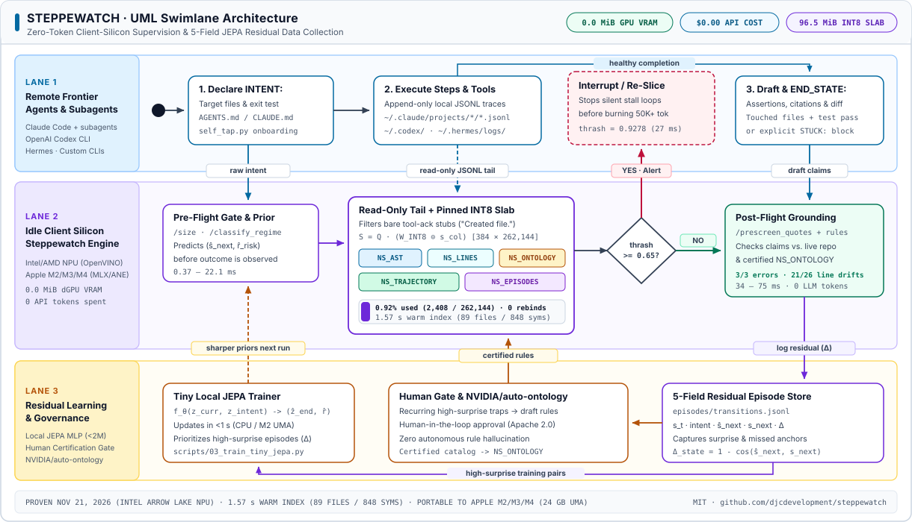

# Steppewatch

**Your laptop already has matrix silicon sitting at 0% while your cloud AI agents burn tokens. Put it to work for `$0.00`.**

[](https://github.com/djcdevelopment/steppewatch/actions/workflows/ci.yml)
[](LICENSE)
[](requirements-m2.txt)
[](PAPER.md)
[](PAPER.md)

**Author:** Derek Ciula · Steppe Integrations · **Date:** November 21, 2026

---

## Why Almost Nobody Tells You This

Cloud AI providers bill by the token — whether your coding agent ships working software, gets stuck paraphrasing the same plan five turns in a row, or hires a *second* cloud model to babysit the first one. Almost no one selling cloud APIs has an incentive to remind you how much unused ML compute you already paid for on your own desk.

Open Activity Monitor or Task Manager while Claude Code, Codex CLI, or Hermes is running. On almost every modern machine — an **Apple Silicon MacBook** (unified memory + Metal GPU + 16-core Neural Engine) or a modern **Intel/AMD NPU laptop** — your dedicated matrix hardware is sitting completely idle.

**Steppewatch** shows you how to reclaim that local hardware in 5 minutes — with **zero API keys, zero network interception, and `$0.00` extra token cost** — for two things:
1. **Watch your remote frontier agents & subagents in real time:** Catch silent polite stall loops in milliseconds and check agent claims against your real codebase before you spend your own review time.
2. **Collect your own local JEPA training data:** Turn every run into a 5-field prediction-residual episode so your machine trains a tiny personal watchdog tuned to *your* repos and *your* agents.



---

## Pick Your Own Starting Point (You Own the Hardware — Test the Math Yourself)

Nothing here asks you to trust marketing claims. Run one command on your own machine and read your own millisecond numbers:

### Option A — 60-Second Dry Run (Just Python + `numpy`, Zero Model Downloads)
```bash
git clone https://github.com/djcdevelopment/steppewatch.git
cd steppewatch
python3 -m venv .venv && source .venv/bin/activate
pip install numpy
python3 scripts/01_see_the_math_m2.py --force-hash --repo .
```

### Option B — Full 5-Minute Run (Real `all-MiniLM-L6-v2` Embeddings + Apple Silicon `MLX` Metal GPU)
On an Apple M2/M3/M4 MacBook (or Linux/Windows laptop), install the full local stack and point it at any git repo you actually work in:
```bash
git clone https://github.com/djcdevelopment/steppewatch.git
cd steppewatch
python3 -m venv .venv && source .venv/bin/activate
pip install -r requirements-m2.txt

# 1. Benchmark your own CPU vs. Metal GPU (up to 262,144 vectors) + test thrash & claim grounding
python3 scripts/01_see_the_math_m2.py --repo /path/to/any/local/repo

# 2. X-Ray your OWN recent Claude Code / Codex / Hermes transcripts read-only & export real JEPA data
python3 scripts/04_xray_my_sessions.py --max-sessions 25 --export-episodes episodes/my_history.jsonl

# 3. Train your personal tiny local JEPA on YOUR real agent history in < 1 second
python3 scripts/03_train_tiny_jepa.py --episodes episodes/my_history.jsonl --out checkpoints/my_real_jepa.npz

# 4. Watch live active sessions & subagents using your newly trained local checkpoint
python3 scripts/02_watch_frontier_agents.py --once --jepa-checkpoint checkpoints/my_real_jepa.npz
```
👉 **Running on an Apple M2/M3/M4 Mac?** Follow the step-by-step **[`COOKBOOK-MAC-M2.md`](COOKBOOK-MAC-M2.md)** — it explains unified memory vs. Neural Engine vs. `MLX` Metal GPU in plain English and shows exactly where Claude Code, Codex CLI, and Hermes already save their local JSONL logs on macOS.

### Option C — Guided 15-Minute Self-Discovery JEPA Workshop (Let Your Agent Drive)
Already live inside Claude Code, Codex CLI, or Hermes? Open **[`WORKSHOP.md`](WORKSHOP.md)** for the full prefilled 4-stage self-discovery prompt (X-Ray your own real transcripts -> train your first real JEPA -> A/B lexical hash vs. `all-MiniLM-L6-v2` -> builder upgrade challenge), or start with this quick self-tap check:

> *"Clone `https://github.com/djcdevelopment/steppewatch.git`, read `AGENTS.md` and `WORKSHOP.md`, run `python3 scripts/self_tap.py --repo .`, and walk me through what my local hardware can do (don't change any global configs without asking me)."*

Everything runs **read-only on local transcripts**, touches **zero API keys**, and gives you clean JSON output ([`AGENTS.md`](AGENTS.md)).

### Option D — Windows 10 / Everyday Laptop (`.NET 10` Native SIMD, Zero Python, Zero NPU/dGPU Required)
Running Windows 10 on an everyday Intel/AMD laptop (no Python `venv`, no `pip`, no discrete GPU needed)? Use the native `.NET 10` CLI (`dotnet/`) directly in PowerShell:
```powershell
git clone https://github.com/djcdevelopment/steppewatch.git
cd steppewatch

# 1. Zero-dependency SIMD benchmark (96.5 MiB INT8 slab vs 384 MiB FP32) + thrash + repo grounding
dotnet run --project dotnet/src/Steppewatch.Cli/Steppewatch.Cli.csproj -c Release -- bench --repo .

# 2. X-Ray your own Claude Code / Codex / Hermes sessions (shows project, intent & stuck-step quotes)
dotnet run --project dotnet/src/Steppewatch.Cli/Steppewatch.Cli.csproj -c Release -- xray --export-episodes episodes/my_history.jsonl

# 3. Train your personal Tiny JEPA in < 1 second & live-watch active sessions
dotnet run --project dotnet/src/Steppewatch.Cli/Steppewatch.Cli.csproj -c Release -- train --episodes episodes/my_history.jsonl --out checkpoints/my_jepa.json
dotnet run --project dotnet/src/Steppewatch.Cli/Steppewatch.Cli.csproj -c Release -- watch --follow --jepa-checkpoint checkpoints/my_jepa.json
```
👉 Want true 384-D neural **`all-MiniLM-L6-v2`** embeddings (`22 MiB` `INT8` CPU or Intel Iris Xe DirectML) with one-command auto-download (`--download-model`) or a single-file `.exe`? Follow **[`COOKBOOK-WIN10-I5.md`](COOKBOOK-WIN10-I5.md)**.

---

## Hermes default and named profiles

The watcher, X-Ray and self-tap discover `~/.hermes/sessions/*.jsonl`, the legacy
`~/.hermes/logs/sessions/*.jsonl`, and `~/.hermes/profiles/*/sessions/*.jsonl`.
Named profiles carry a `hermes:<profile>` source label; the default remains `hermes`.
Each profile's `state.db` supplies sessions without a matching JSONL filename,
using SQLite `mode=ro` and `query_only` on a private workspace-local DB/WAL copy.
The capture retries up to three times if source file identity/size/timestamps
change; SHM is reconstructed only in the private copy. Copies are removed on exit.
On macOS, APFS clones keep large stores cheap; without cloning, captures above
256 MiB are skipped with a warning. Source databases/sidecars are never opened by
SQLite or written. No source messages or database rows are changed.

Override only the Hermes root (not Claude/Codex paths) with `--hermes-home`:

```bash
python3 scripts/04_xray_my_sessions.py --hermes-home /path/to/.hermes --max-sessions 100 --force-hash --json
python3 scripts/02_watch_frontier_agents.py --hermes-home /path/to/.hermes --max-sessions 100 --force-hash --once --json --episodes episodes/hermes.jsonl
python3 -m unittest discover -s tests -v
```

`--max-sessions` is shared across all sources. X-Ray excludes sessions with fewer
than three substantive steps and returns only its top ten in `top_sessions`;
`sessions_by_source` counts all sessions actually evaluated. Discovery and tests
require no additional dependencies or network access.

## How to Read Your Own Numbers (No ML PhD Required)

When `01_see_the_math_m2.py` finishes on your machine, you'll see three concrete local checks:
- **Part A (`262,144`-column random-matrix microbenchmark):** Measures raw batched MatMul throughput on your CPU/Metal/NPU (`96.5 MiB` `INT8+FP16 scales` reference footprint; `192 MiB` `FP16` timed on Apple MLX/MPS). This is synthetic matrix math, not end-to-end retrieval latency.
- **Part B (2-trace synthetic loop smoke check):** Sanity-checks healthy debugging (`0.0000`) vs. a polite paraphrased stall (`0.85+`) at `$0` cloud cost. Real-session flags are **advisory only** (`advisory_inspect_error_loop` / `advisory_inspect_loop`) and should never automatically terminate an agent.
- **Part C (Hybrid candidate grounding):** Indexes symbols from your repo and uses **hybrid exact-symbol lexical + dense retrieval** (plus optional `--rerank` bounded cross-encoder relevance scoring) to surface candidate `file:line` references for human or agent inspection. Relevance scores surface evidence to check — they do not formally prove entailment or falsity.

---

## Real-World Field Testing & Calibration Credit (Apple M2 Option B — Issue #2 & PR #1)

Independent real-session testing by **David Murray (`@thedavidmurray`)** on an Apple M2 (`Mac14,7`, 24 GiB RAM) surfaced four high-value engineering findings that directly shaped `v1.11`:
1. **Hermes default/named-profile & `state.db` coverage ([PR #1](https://github.com/djcdevelopment/steppewatch/pull/1)):** Added read-only multi-profile discovery (`~/.hermes/sessions`, `logs/sessions`, `profiles/*/sessions`, and private APFS-cloned `state.db`+WAL captures).
2. **Real-session false-positive audit ([Issue #2](https://github.com/djcdevelopment/steppewatch/issues/2)):** Manual review of the top-5 Option B MiniLM X-Ray flags found **1/5 true stall** (repeated CLI update/lock failure) and **4/5 false positives** (multi-request QA, similar successful orchestration across distinct tasks, sequential chunk reads, and requested deadline waits). In response, `v1.11` makes all flags strictly **advisory**, segments sliding windows on user-request & compaction boundaries, broadens target/pagination/task-ID progress tracking, distinguishes scheduled wait chatter, and adds regression tests for all five cases.
3. **Hybrid retrieval beats pure MiniLM on exact symbols:** On a second real repository, exact lexical hashing hit Rank `#1` while MiniLM alone fell to Rank `#6` (recovered to `#1` via bounded `cross-encoder/ms-marco-MiniLM-L-6-v2` reranking). `01_see_the_math_m2.py` now fuses exact-symbol lexical scoring with dense vectors by default and exposes opt-in `--rerank`.
4. **Batched X-Ray & honest episode metadata:** Per-window MiniLM encoding took `70.8 s` across 40 real sessions on M2; Python `04_xray_my_sessions.py` now uses single-pass batched encoding (matching `.NET v1.10`), tail-safe JSONL parsing with opening-intent recovery, compaction-wrapper filtering, chronological JEPA validation splits, and explicit `human_label` preference over heuristic proxy risk targets.

---

## Verified Reference Measurements (Intel Arrow Lake NPU — November 21, 2026)

Full methodology, honest misses, and cryptographic receipt digests live in [`PAPER.md`](PAPER.md):

| Capability Measured (OpenVINO INT8/FP16 NPU) | Measured Result | Latency | Extra LLM Tokens |
|---|---|---:|---:|
| **Discrete GPU VRAM contention** | **`0.0 / 0.0 MiB`** (`verified_zero_gpu_fd_binding = true`) | — | `0` |
| **Pinned `262,144`-col INT8 slab** (`96.5 MiB`, `0` rebinds) | `89` files (`848` code + `.md` syms) = **`0.92%` occupied** | **`1.57 s`** warm (`6.50 s` cold) | `0` |
| **Post-flight substance error catch** (vs. frontier audit) | **`3 / 3` real substance errors caught** (Rank #1–#2) | **`34–75 ms`** | `0` |
| **Displaced line-anchor detection** (`23/24` drifted `-8..-25` lines) | **`21 / 26` flagged outside cited span** | **`54–77 ms`** | `0` |
| **Silent polite-stall separation** (`/detect_thrash`) | Productive **`0.0000`** vs. Polite stall **`0.9278`** | **`26.6–27.7 ms`** | `0` |
| **Parallel tool-ack calibration** (Proof Step B) | Filtering bare `"Created file."` stubs: `0.72` -> **`0.0000`** | `< 3 ms` | `0` |

> **Explicit Verification Boundary:** Zero-VRAM NPU slab indexing, post-flight claim grounding, silent-loop thrash separation, parallel tool-ack calibration, and `NS_EPISODES`/`NS_TRAJECTORY` partitioning are live-verified. Multi-week longitudinal JEPA predictor training curves across hundreds of real production trajectories are ongoing evaluation and explicitly not claimed yet.

### Independent Apple M2 Verification (`Mac14,7`, 24 GB Unified Memory — November 21, 2026)

Verified on an independent 2022 13-inch M2 MacBook Pro (`PyTorch MPS` Metal `FP16` `192 MiB` matrix vs. CPU `FP32` `384 MiB` against `262,144 × 384` vectors, Option A zero-download run):

| Batch (`Q` vs. `262,144` vectors) | M2 CPU (`FP32`) | M2 Metal GPU (`FP16`, `192 MiB`) | Speedup |
|---:|---:|---:|---:|
| `Q = 1` | `8.83 ms` | **`8.43 ms`** | `1.05×` |
| `Q = 8` | `34.75 ms` | **`10.14 ms`** | **`3.43×`** |
| `Q = 16` | `46.06 ms` | **`10.20 ms`** | **`4.52×`** |
| `Q = 64` | `64.34 ms` | **`13.71 ms`** | **`4.69×`** |

Scaling from `1` to `16` concurrent queries added only **`+1.77 ms`** on M2 Metal (`8.43 -> 10.20 ms`), while silent-stall detection flagged `0.8635` vs. `0.0000` in **`2.31 ms`** and repo claim grounding indexed `94` symbols in `25.79 ms` (query **`2.78 ms`**). *(Note: `96.5 MiB` is the quantized `INT8 + FP16 scales` slab footprint; the timed Metal matrix above is `192 MiB` in `FP16`.)*

### Everyday Windows 10 Laptop Verification (`i5-12600H`, Zero NPU / Zero dGPU — November 22, 2026)

Verified on a 4-year-old **Dell Precision 3571 (`i5-12600H`, 32 GB RAM, Windows 10 Pro 19045 Hyper-V, Balanced plan)** running the zero-dependency `.NET 10` C# port ([`benchmarks/i5-12600h-win10/`](benchmarks/i5-12600h-win10/README.md), `9/9` xUnit tests, exact `x86_avx2_vpmaddubsw` `INT8` sign-trick kernel — even with Hyper-V hiding AVX-VNNI!):

| Batch (`Q` vs. `262,144` vectors) | Win10 i5 AC `FP32` (`384 MiB`) | Win10 i5 AC Exact `INT8` (`96.5 MiB`) | Win10 i5 Battery `INT8` | AC `INT8` Speedup |
|---:|---:|---:|---:|---:|
| `Q = 1` | `6.89 – 7.45 ms` | **`1.66 – 1.87 ms`** | `1.95 – 1.98 ms` | **`~4.1×`** |
| `Q = 8` | `8.93 – 9.65 ms` | **`3.53 – 4.02 ms`** | `4.62 – 4.72 ms` | **`~2.5×`** |
| `Q = 16` | `14.16 – 16.27 ms` | **`6.51 – 8.70 ms`** | `6.70 – 7.15 ms` | **`~2.0×`** |
| `Q = 64` | `62.66 – 67.34 ms` | **`27.91 – 28.67 ms`** | `28.68 – 30.78 ms` | **`~2.3×`** |

Even on battery with zero NPU and zero discrete GPU, exact `INT8` runs in **`6.70–7.15 ms`** at `Q=16` (`2.0×–4.1×` faster than `FP32` purely by moving `4×` fewer bytes), flags polite stalls in **`1.37 ms`**, and catches repo claims at Rank `#1` in **`1.06 ms`**. With the opt-in `.NET 10` neural ONNX backend ([`COOKBOOK-WIN10-I5.md`](COOKBOOK-WIN10-I5.md#option-3-optional-neural-all-minilm-l6-v2-onnx-runtime-backend-cpu-int8--intel-iris-xe-directml)), real `all-MiniLM-L6-v2` (`21.9 MiB` `INT8` CPU) runs at **`3.19 ms` (`B=1`) / `734 texts/sec` (`B=16`)** with **`16.8×`** sharper zero-overlap paraphrase separation than lexical hashing, indexing `239` symbols in **`534 ms`** and catching the claim at **Rank `#1`** in **`6.2 ms`** (and Intel Iris Xe DirectML runs cleanly too once `DirectML.dll 1.15.4` + static `64/128` buckets are bundled).

---

## Pairs Well With NVIDIA `auto-ontology`

If you use NVIDIA's Apache-2.0 open-source [**`NVIDIA/auto-ontology`**](https://github.com/NVIDIA/auto-ontology) for discovering and human-certifying domain definitions across schemas and docs, Steppewatch plugs cleanly into both ends:

- **Certified Catalog -> Zero-Token Guardrails:** Load human-certified definitions from `NVIDIA/auto-ontology` into your local `NS_ONTOLOGY` slab so your Mac or NPU checks frontier agent claims against them in milliseconds at `$0.00` token cost — even when an agent skips an MCP query.
- **Residual Surprises -> Human Certification Queue:** Feed recurring high-surprise failures from Steppewatch's `episodes/transitions.jsonl` back into `auto-ontology`'s human-in-the-loop review workflow so real agent mistakes continuously tighten your certified catalog.

---

## Repository Map

| File | Purpose |
|---|---|
| [`WORKSHOP.md`](WORKSHOP.md) | **Guided 15-Minute JEPA Self-Discovery Workshop** — Copy-paste interactive agent prompt + 4 hands-on checkpoints using your own real transcripts (X-Ray -> train real JEPA -> hash vs. MiniLM A/B -> builder challenges). |
| [`LOCAL-POWER-PACK-M2.md`](LOCAL-POWER-PACK-M2.md) | **24 GB Apple M2 Local Power Pack** — Bandwidth-honest guide to attention-heavy local models (`ModernBERT` / `Qwen3-Embedding` + cross-attention `Qwen3-Reranker` + `mlx-lm` speculative / native-MTP `MiMo-7B` & solo `Qwen3.5-35B-A3B` MoE). |
| [`COOKBOOK-MAC-M2.md`](COOKBOOK-MAC-M2.md) | **Apple M2 Builder's Cookbook** — Step-by-step guide tailored to 24 GB unified-memory Macs (`Mac14,7`), ANE vs. `MLX` Metal GPU physics, transcript paths, and local JEPA data collection. |
| [`COOKBOOK-WIN10-I5.md`](COOKBOOK-WIN10-I5.md) | **Windows 10 & 12th-Gen Core i5 Cookbook (`.NET 10` Native SIMD)** — Zero-Python C# CLI (`dotnet/`) exercising hardware `AVX-VNNI` `INT8` (`96.5 MiB` slab) and `AVX2+FMA` on everyday laptops with no NPU or discrete GPU, publishable as a single-file `steppewatch.exe`. |
| [`AGENTS.md`](AGENTS.md) | **Agent Self-Tap Protocol** — Machine-first guide for Claude Code, Codex CLI, Hermes, and subagents to bootstrap, self-check, and supervise safely in JSON. |
| [`PAPER.md`](PAPER.md) | **Technical Preprint (`v1.1`)** — Formal architecture, UML sequence diagram, live Arrow Lake NPU benchmarks (Proof A & B), Apple Silicon mapping, and `NVIDIA/auto-ontology` interop. |
| [`docs/EXPLAINER-BRIEF-NOTEBOOKLM.md`](docs/EXPLAINER-BRIEF-NOTEBOOKLM.md) | **Explainer Video / Audio Source Brief** — Narrative source file ready to drop into NotebookLM to generate a 3–5 minute explainer video or podcast overview. |
| [`rules/frontier-agent-watchdog-skill.md`](rules/frontier-agent-watchdog-skill.md) | **Drop-In Starter Ruleset / Skill** — `INTENT:`, `STUCK:`, grounded-claims-only, compact `END_STATE:` receipt, and disjoint subagent targets. |
| [`scripts/self_tap.py`](scripts/self_tap.py) | **One-Command Agent Self-Tap Probe** — Detects hardware/backends, finds active Claude/Codex/Hermes logs, runs a fast self-check, and emits structured JSON onboarding instructions. |
| [`scripts/01_see_the_math_m2.py`](scripts/01_see_the_math_m2.py) | **Hardware Benchmark & Proof** — Batched `[Q, 384] @ [384, 262144]` slab timing, thrash separation, and local repo claim grounding. |
| [`scripts/02_watch_frontier_agents.py`](scripts/02_watch_frontier_agents.py) | **Live Read-Only Watcher (`--json` supported)** — Tails Claude Code (+ subagents), Codex, and Hermes JSONL logs, filters bare tool-ack stubs, flags loops/stalls, and logs 5-field episodes. |
| [`scripts/03_train_tiny_jepa.py`](scripts/03_train_tiny_jepa.py) | **Tiny Local JEPA Trainer** — Trains a compact `384-D` latent state + stall-risk MLP predictor on collected episodes (`--demo-synthetic` supported) and saves a `.npz` checkpoint. |
| [`scripts/04_xray_my_sessions.py`](scripts/04_xray_my_sessions.py) | **Retrospective Session X-Ray (`--json` supported)** — Replays `W=5` sliding windows across your existing Claude/Codex/Hermes history to spot past stall loops, rank intent-drift surprises, and export real 5-field JEPA training data immediately. |
| [`SECURITY.md`](SECURITY.md) | **Security & Privacy Posture** — Zero-network runtime, read-only transcript/SQLite guarantees, and private-log hygiene. |
| [`CONTRIBUTING.md`](CONTRIBUTING.md) | **Contributor Guide** — Offline test commands, synthetic-fixture rules, and field-testing credits. |
| [`MANIFEST.sha256`](MANIFEST.sha256) | Cryptographic SHA-256 provenance manifest for all repository files. |

---

## License & Commercial Support

Steppewatch is released under the [**MIT License**](LICENSE) (`Copyright (c) 2026 Derek Ciula / Steppe Integrations`) as an open builder workshop, starter toolkit, and public prior-art reference.

For production hardware-tuned NPU/GPU agent supervision, custom enterprise agent governance, or integration consulting, reach out to **Steppe Integrations** (`derek@steppeintegrations.com`).

